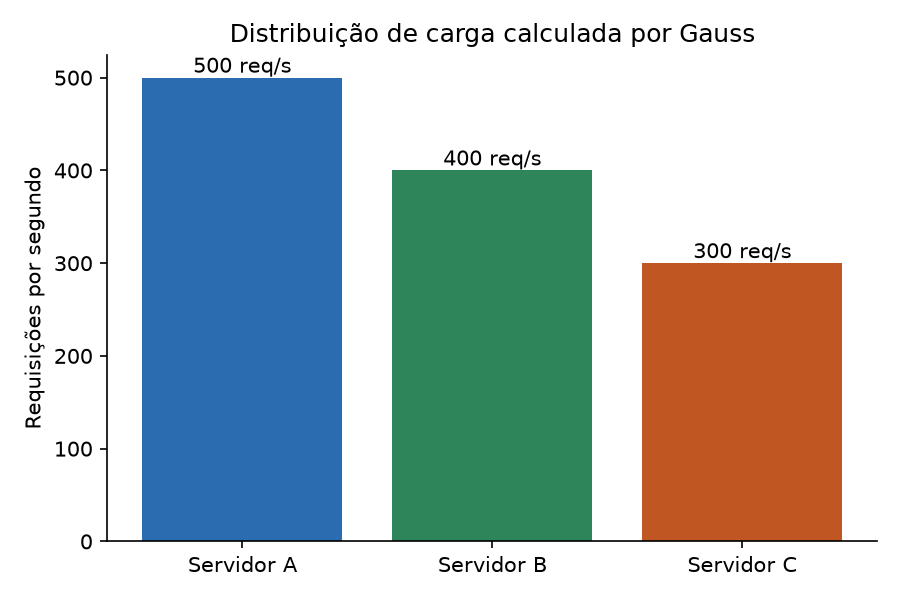
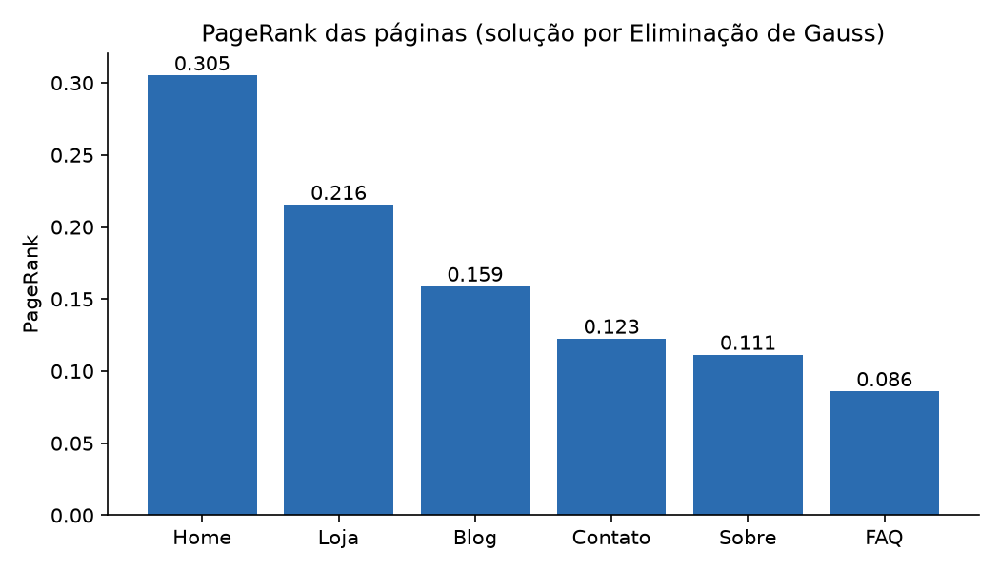
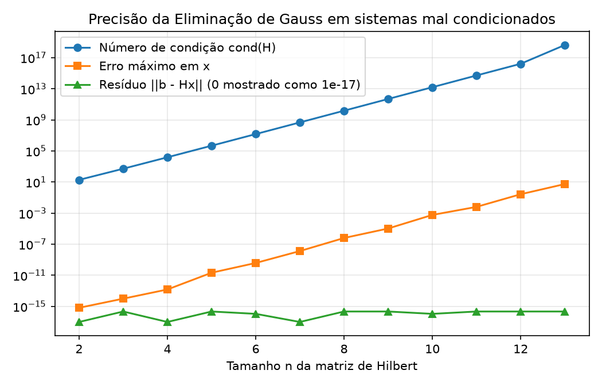
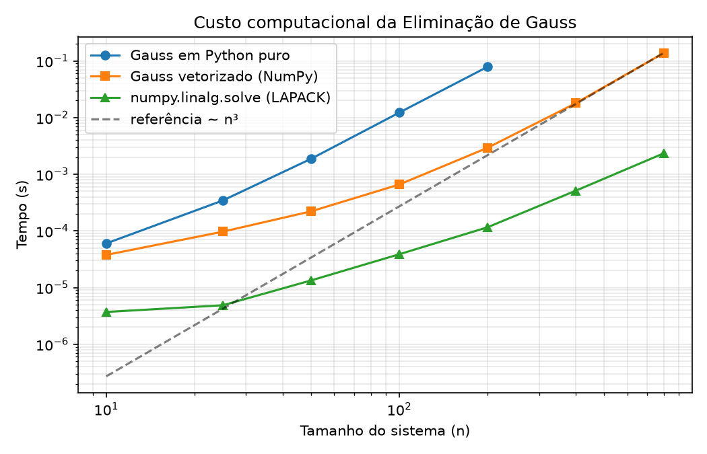
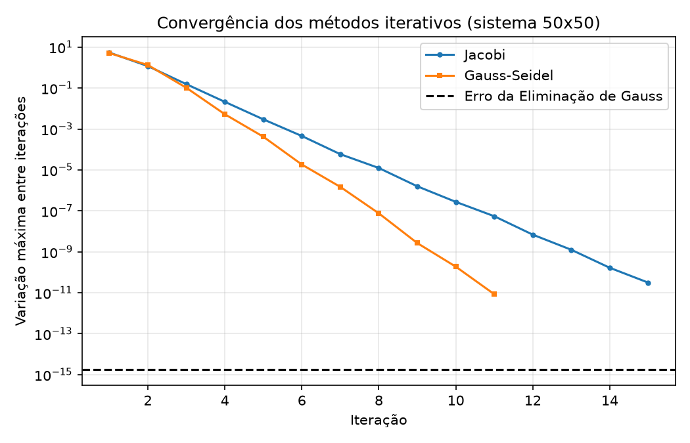

# Eliminação de Gauss: Sistemas Lineares na Computação

Trabalho da 2ª avaliação de **Cálculo Numérico** (Ciência da Computação, UNIESP, 2026.2).

Este repositório traz a implementação do **Método de Eliminação de Gauss** em Python, com:

- resolução passo a passo e **exata (com frações)** dos exemplos vistos em aula;
- duas aplicações práticas da computação: **balanceamento de carga entre servidores** e **PageRank**;
- **análise de precisão** (pivoteamento e sistemas mal condicionados);
- **comparação de desempenho** com o NumPy/LAPACK e com os métodos iterativos de **Jacobi** e **Gauss-Seidel**;
- gráficos e testes automatizados.

O relatório completo está em [RELATORIO.md](RELATORIO.md).

## Estrutura

```
.
├── gauss.py          # Eliminação de Gauss (didática + vetorizada), retrossubstituição, resíduo
├── iterativos.py     # Jacobi e Gauss-Seidel (para comparação)
├── main.py           # Demonstração completa: exemplos, aplicações, precisão, desempenho
├── tests/            # Testes automatizados (unittest)
├── resultados/       # Gráficos gerados e saída do programa (saida.txt)
├── RELATORIO.md      # Relatório acadêmico
└── requirements.txt
```

## Como executar

```bash
python3 -m venv .venv
source .venv/bin/activate        # Windows: .venv\Scripts\activate
pip install -r requirements.txt

python main.py                   # roda tudo e gera os gráficos em resultados/
python -m unittest discover -s tests -v
```

## Uso rápido

```python
from gauss import eliminacao_gauss, resolver_e_mostrar

# Solução numérica (float, com pivoteamento parcial)
x, _ = eliminacao_gauss([[1, 2, 1], [2, 1, 3], [3, 2, 2]], [9, 13, 14])

# Passo a passo com frações, igual à resolução no caderno
resolver_e_mostrar([[1, 2, 1], [2, 1, 3], [3, 2, 2]], [9, 13, 14], ["x", "y", "z"])
# ...
# Solução: x = 8/7, y = 18/7, z = 19/7
```

## Resultados

| Balanceamento de carga | PageRank |
|---|---|
|  |  |

| Precisão (matriz de Hilbert) | Desempenho |
|---|---|
|  |  |


