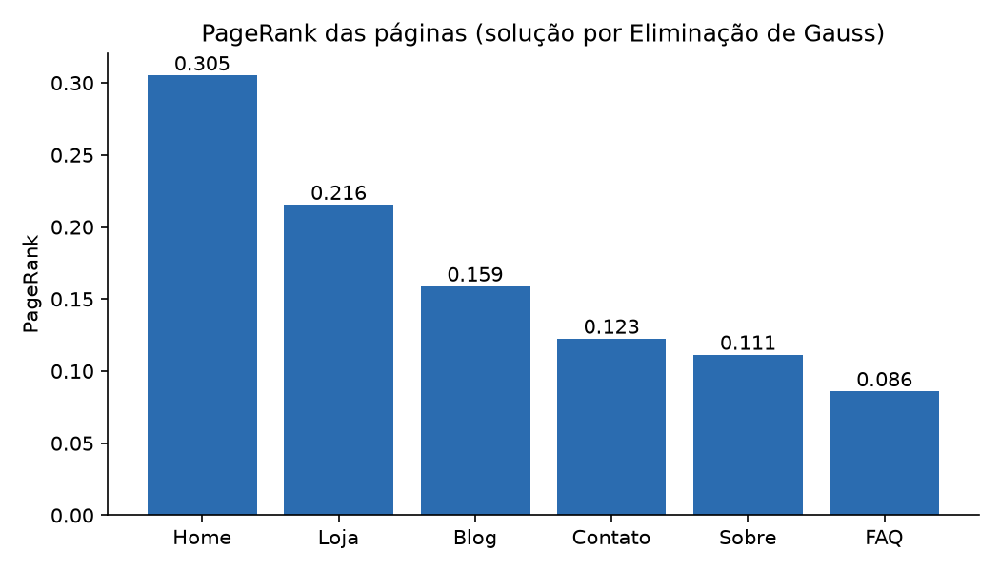
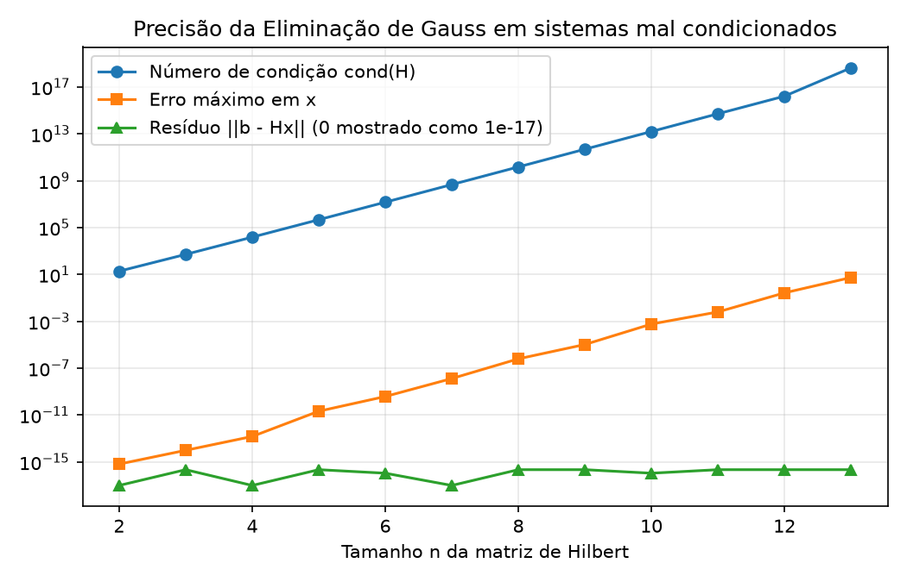
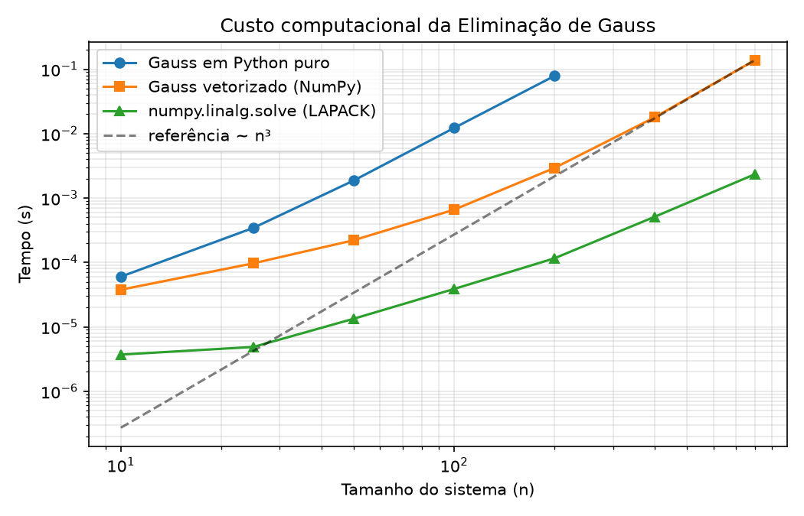
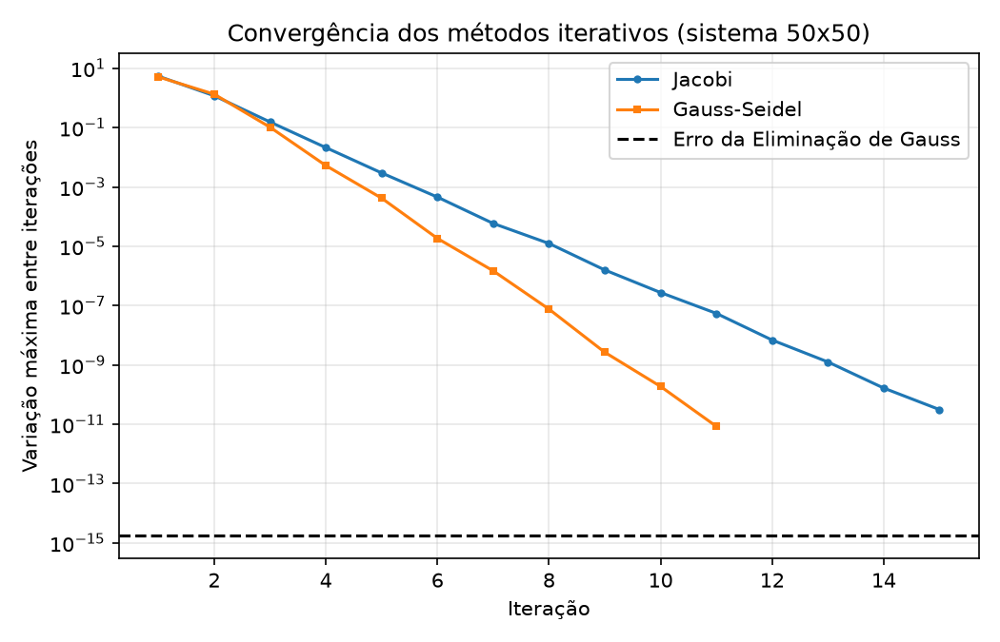

# Relatório: Eliminação de Gauss e suas Aplicações na Ciência da Computação

## 1. Capa

| | |
|---|---|
| **Instituição** | Centro Universitário UNIESP |
| **Curso** | Ciência da Computação |
| **Disciplina** | Cálculo Numérico |
| **Título** | Sistemas Lineares: o Método de Eliminação de Gauss aplicado a problemas computacionais |
| **Integrantes** | _[nome 1]_, _[nome 2]_, _[nome 3]_ |
| **Professora** | Ma. Isabelly Diniz |
| **Cidade e ano** | João Pessoa, 2026 |

---

## 2. Introdução (Etapa 1: Contextualização)

Um **sistema linear** é um conjunto de equações em que todas as incógnitas aparecem
apenas no primeiro grau. Em forma matricial ele é escrito como

$$A\,x = b,$$

em que $A$ é a matriz $n \times n$ dos coeficientes, $x$ é o vetor de incógnitas e $b$ é o
vetor dos termos independentes.

Sistemas lineares aparecem em praticamente todas as áreas da computação. Alguns exemplos:

- **Computação gráfica**: transformações geométricas, interpolação e renderização por
  radiosidade.
- **Aprendizado de máquina**: a regressão linear por mínimos quadrados se reduz às
  equações normais $A^TA\,w = A^Tb$.
- **Redes e sistemas distribuídos**: distribuição de carga e análise de fluxo.
- **Motores de busca**: o PageRank do Google pode ser calculado resolvendo um sistema linear.
- **Simulação**: as equações diferenciais de física, circuitos e calor, depois de discretizadas,
  viram sistemas lineares enormes.

Na prática, esses sistemas têm centenas, milhares ou milhões de incógnitas, o que torna
impossível resolvê-los à mão. Por isso precisamos de **algoritmos**: procedimentos
sistemáticos, automatizáveis e com custo conhecido. O **Método de Eliminação de Gauss**
é o algoritmo direto mais clássico para isso e é a base da fatoração LU usada pelas
bibliotecas numéricas modernas (LAPACK, NumPy, MATLAB).

**Objetivos do trabalho:**

1. explicar o fundamento matemático do método de Gauss;
2. mostrar onde ele é usado na computação, com dois problemas reais;
3. implementar o método em Python e validar com os exemplos da aula;
4. analisar a precisão (erros de arredondamento) e o custo computacional;
5. comparar com outras abordagens (biblioteca LAPACK e métodos iterativos).

---

## 3. Fundamentação teórica (Etapa 2)

### 3.1 Ideia do método

O método transforma o sistema original em um **sistema equivalente** (com a mesma
solução) cuja matriz é **triangular superior**:

$$
\begin{cases}
a_{11}x_1 + a_{12}x_2 + \cdots + a_{1n}x_n = b_1 \\
\phantom{a_{11}x_1 +{}} a_{22}x_2 + \cdots + a_{2n}x_n = b_2 \\
\phantom{a_{11}x_1 + a_{12}x_2 +{}} \ddots \qquad\ \ \vdots \\
\phantom{a_{11}x_1 + a_{12}x_2 + \cdots +{}} a_{nn}x_n = b_n
\end{cases}
$$

Um sistema triangular se resolve facilmente "de baixo para cima" (**retrossubstituição**).

### 3.2 Operações elementares

Para triangularizar usamos três operações sobre as linhas, que não mudam a solução:

1. trocar duas linhas: $L_i \leftrightarrow L_j$;
2. multiplicar uma linha por uma constante $k \neq 0$: $L_i \leftarrow k\,L_i$;
3. somar a uma linha um múltiplo de outra: $L_i \leftarrow L_i - m\,L_j$.

### 3.3 Fase 1: Eliminação

Para cada coluna $k = 1, \dots, n-1$, o elemento $a_{kk}$ é o **pivô**. Para cada linha
$i > k$ calculamos o **multiplicador**

$$m_{ik} = \frac{a_{ik}}{a_{kk}}$$

e fazemos $L_i \leftarrow L_i - m_{ik}\,L_k$, ou seja,

$$a_{ij} \leftarrow a_{ij} - m_{ik}\,a_{kj}, \qquad b_i \leftarrow b_i - m_{ik}\,b_k .$$

Isso zera todos os elementos abaixo do pivô.

### 3.4 Fase 2: Retrossubstituição

$$x_n = \frac{b_n}{a_{nn}}, \qquad
x_i = \frac{1}{a_{ii}}\left(b_i - \sum_{j=i+1}^{n} a_{ij}\,x_j\right), \quad i = n-1, \dots, 1.$$

### 3.5 Pivoteamento parcial

Se o pivô for zero, a divisão é impossível. Se for **muito pequeno**, o multiplicador fica
enorme e amplifica os erros de arredondamento do computador. A estratégia de
**pivoteamento parcial** escolhe como pivô o elemento de **maior valor absoluto** da coluna
(da linha $k$ para baixo) e troca as linhas antes de eliminar:

$$p = \arg\max_{i \ge k} |a_{ik}|, \qquad L_k \leftrightarrow L_p.$$

Assim $|m_{ik}| \le 1$ e o método fica numericamente estável.

### 3.6 Custo computacional

Contando as operações de ponto flutuante, a eliminação faz aproximadamente
$\frac{2}{3}n^3$ operações e a retrossubstituição faz $n^2$. Logo o método é
$O(n^3)$: **dobrar o tamanho do sistema multiplica o tempo por cerca de 8**.

### 3.7 Condicionamento e erro

O computador representa números reais em ponto flutuante (padrão IEEE 754, com cerca de
16 dígitos significativos em `float64`). Mesmo com um algoritmo estável, o erro da
solução depende do **número de condição** da matriz:

$$\kappa(A) = \|A\|\,\|A^{-1}\|, \qquad
\frac{\|x - \tilde{x}\|}{\|x\|} \lesssim \kappa(A)\cdot \varepsilon_{\text{máquina}} .$$

Na prática, perdemos cerca de $\log_{10}\kappa(A)$ dígitos de precisão. Para avaliar a
qualidade de uma solução aproximada $\tilde{x}$ usamos também o **resíduo**
$r = b - A\tilde{x}$.

### 3.8 Métodos iterativos (para comparação)

- **Jacobi**: $x_i^{(k+1)} = \dfrac{1}{a_{ii}}\Big(b_i - \sum_{j\ne i} a_{ij}x_j^{(k)}\Big)$.
- **Gauss-Seidel**: igual ao Jacobi, mas usa imediatamente os valores já atualizados na
  mesma iteração.

Os dois convergem com garantia quando $A$ é **estritamente diagonal dominante**
($|a_{ii}| > \sum_{j\neq i}|a_{ij}|$).

---

## 4. Aplicações na Ciência da Computação (Etapa 3)

### 4.1 Balanceamento de carga em sistemas distribuídos

- **Problema computacional:** um balanceador de carga precisa decidir quantas
  requisições por segundo enviar a cada servidor de um cluster heterogêneo de forma que a
  demanda seja atendida e os recursos (CPU, rede) sejam aproveitados por completo.
- **Por que um método numérico?** Cada recurso gera uma equação linear. Com muitos
  servidores e recursos, o sistema cresce e precisa ser recalculado automaticamente sempre
  que a demanda muda, sem intervenção humana.
- **Como o método ajuda:** a eliminação de Gauss resolve o sistema num número fixo e
  previsível de passos, o que é importante para um software que roda em tempo real.
- **Vantagens:** solução exata (a menos de arredondamento), custo previsível e
  implementação simples.
- **Limitações:** exige que o sistema tenha solução única (matriz não singular); a solução
  pode dar valores negativos ou fracionários, que precisam ser tratados pelo software;
  custo $O(n^3)$ para clusters muito grandes.

### 4.2 PageRank (motores de busca)

- **Problema computacional:** ordenar páginas da web por importância a partir dos links
  entre elas.
- **Modelo:** o PageRank $r$ é a probabilidade de um "navegador aleatório" estar em cada
  página. Ele satisfaz $r = d\,M\,r + \frac{1-d}{n}\mathbf{1}$, em que
  $M_{ij} = 1/\text{(nº de links da página } j)$ quando $j$ aponta para $i$, e $d = 0{,}85$.
  Reorganizando, chegamos ao sistema linear

  $$(I - d\,M)\,r = \frac{1-d}{n}\,\mathbf{1}.$$

- **Por que um método numérico?** A web tem bilhões de páginas, então só um algoritmo
  consegue resolver.
- **Como o método ajuda:** para grafos pequenos e médios, Gauss dá a solução direta e exata.
  Para a web inteira, usam-se métodos iterativos (método da potência), mas o modelo
  continua sendo um sistema linear.
- **Vantagens:** a resposta é exata e não depende de um critério de parada.
- **Limitações:** para $n$ gigantesco, o custo $O(n^3)$ e a memória $O(n^2)$ inviabilizam
  o método direto, e aí os iterativos são preferidos.

---

## 5. Desenvolvimento do exemplo numérico (Etapa 4)

### 5.1 Descrição do problema

Uma empresa tem um cluster com três servidores, A, B e C, de hardware diferente.
Precisamos descobrir quantas requisições por segundo ($x$, $y$, $z$) devem ser enviadas a
cada servidor.

### 5.2 Dados utilizados

| Recurso | Servidor A | Servidor B | Servidor C | Total disponível |
|---|---|---|---|---|
| Requisições (req/s) | 1 | 1 | 1 | 1200 req/s |
| CPU por requisição (ms) | 2 | 3 | 4 | 3400 ms de CPU/s |
| Banda por requisição (Mbps) | 0,5 | 0,8 | 1,2 | 930 Mbps |

### 5.3 Modelo matemático

$$
\begin{cases}
x + y + z = 1200 \\
2x + 3y + 4z = 3400 \\
0{,}5x + 0{,}8y + 1{,}2z = 930
\end{cases}
\qquad
\left[\begin{array}{ccc|c}
1 & 1 & 1 & 1200 \\
2 & 3 & 4 & 3400 \\
0{,}5 & 0{,}8 & 1{,}2 & 930
\end{array}\right]
$$

### 5.4 Resolução pelo método de Gauss

**Passo 1: zerar abaixo do pivô na coluna 1** (pivô $a_{11} = 1$)

- $L_2 \leftarrow L_2 - 2L_1$
- $L_3 \leftarrow L_3 - 0{,}5L_1$

$$
\left[\begin{array}{ccc|c}
1 & 1 & 1 & 1200 \\
0 & 1 & 2 & 1000 \\
0 & 0{,}3 & 0{,}7 & 330
\end{array}\right]
$$

**Passo 2: zerar abaixo do pivô na coluna 2** (pivô $a_{22} = 1$)

- $L_3 \leftarrow L_3 - 0{,}3L_2$

$$
\left[\begin{array}{ccc|c}
1 & 1 & 1 & 1200 \\
0 & 1 & 2 & 1000 \\
0 & 0 & 0{,}1 & 30
\end{array}\right]
$$

**Passo 3: retrossubstituição**

- $0{,}1z = 30 \Rightarrow z = 300$
- $y + 2(300) = 1000 \Rightarrow y = 400$
- $x + 400 + 300 = 1200 \Rightarrow x = 500$

**Verificação:** $2(500) + 3(400) + 4(300) = 3400$ ✔ e
$0{,}5(500) + 0{,}8(400) + 1{,}2(300) = 930$ ✔

### 5.5 Interpretação dos resultados

O balanceador deve enviar **500 req/s ao servidor A, 400 req/s ao B e 300 req/s ao C**.
O servidor A, que é o mais "leve" por requisição (gasta menos CPU e banda), recebe a maior
fatia do tráfego, e o C, que é o mais "pesado", recebe a menor. O programa chegou ao
mesmo resultado com resíduo $\|b - Ax\|_\infty = 0$ (veja `resultados/saida.txt`).

> Observação: o programa usa pivoteamento parcial, por isso começa trocando $L_1$ com
> $L_2$ (o maior valor da coluna 1 é 2). O caminho é diferente da resolução manual, mas a
> solução é a mesma, como esperado de sistemas equivalentes.

### 5.6 Exemplos da aula conferidos pelo programa

| Sistema | Solução obtida |
|---|---|
| $2x+3y+3z=13$; $x-7y+2z=17$; $5x+8y-z=-2$ | $x=2,\ y=-1,\ z=4$ |
| $x+2y+z=9$; $2x+y+3z=13$; $3x+2y+2z=14$ (servidores) | $x=\tfrac{8}{7},\ y=\tfrac{18}{7},\ z=\tfrac{19}{7}$ |
| Sistema 4×4 ($x, y, z, w$) | $x=2,\ y=2,\ z=1,\ w=-3$ |
| "Para praticar": $a+b+c=6$; $2a+3b+c=14$; $a+4b+3c=20$ | $a=\tfrac{4}{5},\ b=\tfrac{18}{5},\ c=\tfrac{8}{5}$ |

Para o exercício "para praticar": $L_2 \leftarrow L_2 - 2L_1$ e $L_3 \leftarrow L_3 - L_1$
dão $b - c = 2$ e $3b + 2c = 14$; depois $L_3 \leftarrow L_3 - 3L_2$ dá $5c = 8$. Logo
$c = 8/5$, $b = 18/5$ e $a = 6 - 18/5 - 8/5 = 4/5$.

---

## 6. Implementação computacional (Etapa 5)

### 6.1 Organização do código

| Arquivo | Conteúdo |
|---|---|
| `gauss.py` | `eliminacao_gauss` (didática, aceita `float` ou `Fraction` e registra cada operação), `eliminacao_gauss_numpy` (vetorizada), `retrossubstituicao`, `residuo` |
| `iterativos.py` | `jacobi`, `gauss_seidel`, `diagonal_dominante` |
| `main.py` | executa todas as demonstrações e gera os gráficos |
| `tests/test_gauss.py` | 10 testes automatizados (exemplos da aula, comparação com NumPy, matriz singular, pivoteamento) |

### 6.2 Núcleo do algoritmo

```python
for k in range(n - 1):
    # pivoteamento parcial: maior |a_ik| da coluna k
    p = max(range(k, n), key=lambda i: abs(M[i][k]))
    M[k], M[p] = M[p], M[k]
    v[k], v[p] = v[p], v[k]

    # eliminação: L_i <- L_i - m_ik * L_k
    for i in range(k + 1, n):
        m = M[i][k] / M[k][k]
        for j in range(k, n):
            M[i][j] -= m * M[k][j]
        v[i] -= m * v[k]

# retrossubstituição
for i in range(n - 1, -1, -1):
    x[i] = (v[i] - sum(M[i][j] * x[j] for j in range(i + 1, n))) / M[i][i]
```

Um detalhe útil: como o código só usa `+ - * /`, ele funciona com `fractions.Fraction`.
Assim o programa reproduz **exatamente** as frações da resolução manual (por exemplo,
$z = 19/7$), sem nenhum erro de arredondamento.

### 6.3 Resultados obtidos

**PageRank** de um site com 6 páginas (Home, Blog, Loja, Contato, Sobre, FAQ):

| Página | PageRank (Gauss) | PageRank (método da potência) |
|---|---|---|
| Home | 0,305267 | 0,305267 |
| Loja | 0,215602 | 0,215602 |
| Blog | 0,158877 | 0,158877 |
| Contato | 0,122674 | 0,122674 |
| Sobre | 0,111492 | 0,111492 |
| FAQ | 0,086087 | 0,086087 |

Os dois métodos concordam até $10^{-13}$. A Home é a mais importante porque quase todas
as páginas apontam para ela.



### 6.4 Análise da precisão

**a) A importância do pivoteamento.** Considere o sistema
$10^{-20}x_1 + x_2 = 1$, $x_1 + x_2 = 2$, cuja solução é $x_1 \approx x_2 \approx 1$.

| Estratégia | $x_1$ | $x_2$ |
|---|---|---|
| Sem pivoteamento | **0,000000** ❌ | 1,000000 |
| Pivoteamento parcial | 1,000000 ✔ | 1,000000 |

Sem pivoteamento o multiplicador é $10^{20}$ e o termo "1" da segunda equação some no
arredondamento ($1 - 10^{20}$ vira $-10^{20}$). A informação se perde e $x_1$ sai errado.

**b) Sistemas mal condicionados (matriz de Hilbert, $H_{ij} = \frac{1}{i+j-1}$).**
Com solução exata $x = (1, \dots, 1)$:

| $n$ | $\kappa(H)$ | Erro máximo em $x$ | Resíduo |
|---|---|---|---|
| 4 | $1{,}6\times10^{4}$ | $1{,}5\times10^{-13}$ | $\approx 0$ |
| 8 | $1{,}5\times10^{10}$ | $6{,}4\times10^{-7}$ | $2{,}2\times10^{-16}$ |
| 10 | $1{,}6\times10^{13}$ | $5{,}9\times10^{-4}$ | $1{,}1\times10^{-16}$ |
| 12 | $1{,}7\times10^{16}$ | $2{,}7\times10^{-1}$ | $2{,}2\times10^{-16}$ |
| 13 | $4{,}3\times10^{18}$ | $5{,}6$ | $2{,}2\times10^{-16}$ |

O resíduo continua minúsculo (o algoritmo é estável), mas o erro em $x$ cresce junto com
$\kappa(H)$. Isso confirma na prática a relação $\text{erro} \lesssim \kappa \cdot \varepsilon$:
**um resíduo pequeno não garante uma solução precisa quando a matriz é mal condicionada.**



### 6.5 Comparação entre métodos

**Desempenho** (tempo em segundos, sistemas aleatórios):

| $n$ | Gauss em Python puro | Gauss vetorizado (NumPy) | `numpy.linalg.solve` (LAPACK) |
|---|---|---|---|
| 100 | 0,012 | 0,0007 | 0,00004 |
| 200 | 0,083 | 0,0029 | 0,00012 |
| 800 | — | 0,139 | 0,0024 |

_(Os tempos variam conforme a máquina; os valores acima são de uma execução de
referência e estão em `resultados/saida.txt`.)_

O crescimento segue a curva $n^3$. A LAPACK usa o **mesmo método** (fatoração LU com
pivoteamento parcial), mas em código compilado e otimizado para cache e instruções
vetoriais do processador. Por isso é dezenas de vezes mais rápida.



**Direto × iterativo** (sistema 50×50 diagonal dominante):

| Método | Iterações | Erro máximo |
|---|---|---|
| Eliminação de Gauss | — (passos fixos) | $1{,}8\times10^{-15}$ |
| Jacobi | 15 | $5{,}5\times10^{-12}$ |
| Gauss-Seidel | 11 | $8{,}1\times10^{-13}$ |

O Gauss-Seidel converge mais rápido que o Jacobi por aproveitar valores já atualizados.
O método direto é o mais preciso, mas os iterativos ganham em sistemas enormes e esparsos,
porque não precisam armazenar nem modificar a matriz inteira.



---

## 7. Conclusão (Etapa 6)

O Método de Eliminação de Gauss transforma um problema aparentemente complexo, resolver
várias equações ao mesmo tempo, em uma sequência simples e repetitiva de operações. É
exatamente o tipo de procedimento que um computador executa bem. Neste trabalho vimos que:

- o método resolveu corretamente todos os exemplos da aula, inclusive de forma **exata**
  com frações;
- problemas reais da computação, como **balanceamento de carga** e **PageRank**, podem ser
  modelados como sistemas lineares e resolvidos com ele;
- o **pivoteamento parcial** é indispensável: sem ele, um único pivô pequeno destrói a
  resposta;
- o **condicionamento** da matriz limita a precisão possível, independente do algoritmo;
- o custo $O(n^3)$ explica por que bibliotecas otimizadas (LAPACK) e métodos iterativos são
  usados em problemas grandes.

Para o profissional de Ciência da Computação, entender esse método vai além de saber
resolver um sistema. Envolve conhecer a **complexidade de algoritmos**, os **limites da
aritmética de ponto flutuante** e a **escolha da ferramenta certa** para cada escala de
problema. Esses conhecimentos estão por trás de bibliotecas que usamos todos os dias em
computação gráfica, ciência de dados, aprendizado de máquina e sistemas distribuídos.

---

## 8. Referências bibliográficas

- RUGGIERO, M. A. G.; LOPES, V. L. R. **Cálculo Numérico: aspectos teóricos e
  computacionais**. 2. ed. São Paulo: Pearson Makron Books, 1996.
- BURDEN, R. L.; FAIRES, J. D. **Análise Numérica**. Tradução da 8. ed. São Paulo:
  Cengage Learning, 2008.
- FRANCO, N. B. **Cálculo Numérico**. São Paulo: Pearson Prentice Hall, 2006.
- GOLUB, G. H.; VAN LOAN, C. F. **Matrix Computations**. 4. ed. Baltimore: Johns Hopkins
  University Press, 2013.
- TREFETHEN, L. N.; BAU, D. **Numerical Linear Algebra**. Philadelphia: SIAM, 1997.
- PAGE, L.; BRIN, S.; MOTWANI, R.; WINOGRAD, T. **The PageRank Citation Ranking:
  Bringing Order to the Web**. Stanford InfoLab, Technical Report, 1999.
- LANGVILLE, A. N.; MEYER, C. D. **Google's PageRank and Beyond: The Science of Search
  Engine Rankings**. Princeton University Press, 2006.
- DINIZ, I. **Aula 07: Sistemas Lineares**. Notas de aula de Cálculo Numérico. UNIESP, 2026.
- NUMPY DEVELOPERS. **numpy.linalg.solve**. Documentação oficial do NumPy. Disponível em:
  <https://numpy.org/doc/stable/reference/generated/numpy.linalg.solve.html>.
